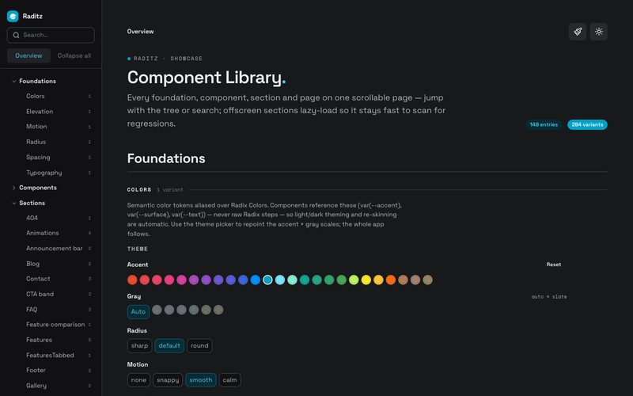
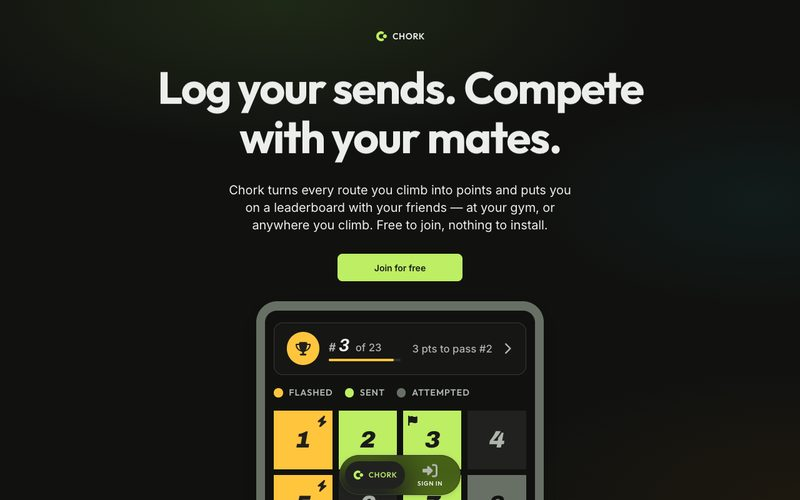
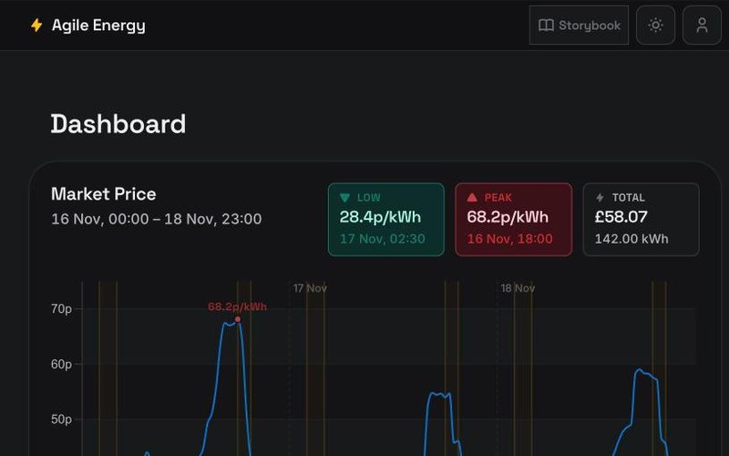

## Hi, I'm Tom

I'm a frontend developer in Guildford, Surrey. I've been building with React, Next.js and TypeScript since 2021, first at [Rocketmakers](https://www.rocketmakers.com) in Bath, then at Neverbland in London, plus a couple of freelance builds for the Financial Times.

I like doing the design as well as the code. Lately that's meant building my own things, using AI where it helps.

### Things I've made

<table>
  <tr>
    <td width="33%" valign="top">
      
      
<b><a href="https://github.com/tmhnsly/raditz">Raditz</a></b> 
      An exploration of how an accessible, themeable component library and design system could work. 
      <a href="https://raditz-nine.vercel.app">Showcase</a>

    </td>
    <td width="33%" valign="top">
      
      
<b><a href="https://github.com/tmhnsly/chork">Chork</a></b> 
      A climbing app. Run a bouldering comp at your wall and everyone shares one live leaderboard. 
      <a href="https://chork.app">chork.app</a>

    </td>
    <td width="33%" valign="top">
      
      
<b><a href="https://github.com/tmhnsly/agile-energy-dashboard">Agile Energy</a></b> 
      Octopus Agile electricity prices, and the cheapest times to run the washing machine. 
      <a href="https://agile-energy-dashboard.vercel.app">Live</a>

    </td>
  </tr>
</table>

There's more on [tomhinsley.com](https://tomhinsley.com), including the films and music I make when I'm not coding.

I'm looking for frontend or design engineer roles, remote or hybrid in London. Say hello at [hello@tomhinsley.com](mailto:hello@tomhinsley.com) or on [LinkedIn](https://www.linkedin.com/in/tmhnsly/).
